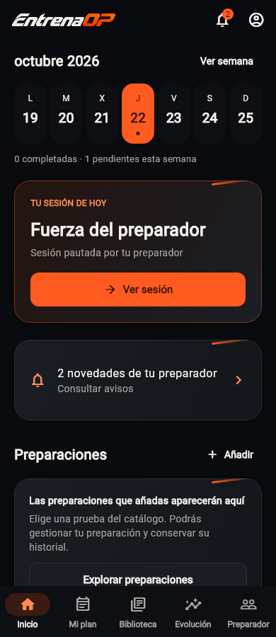
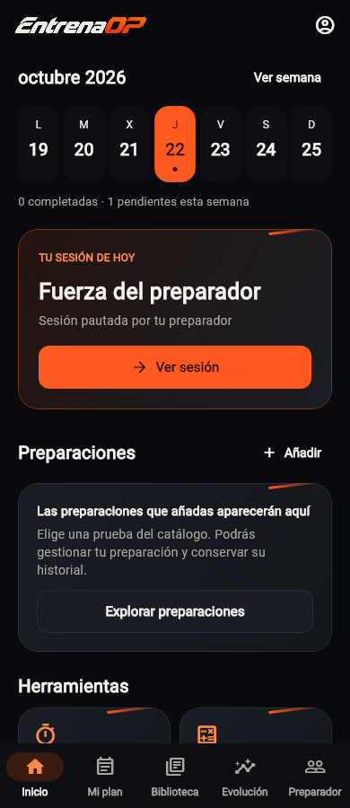

# Navegación del alumno y preparador · TRN-025 · 22/10/2026

## Elección de Javier

Preparador abajo, Perfil arriba e Inicio despejado. La campana se oculta por
completo con cero avisos sin leer, para que no parezca un control de sonido.
Mantener avisos, historial y las planificaciones coexistentes. Sin agentes ni
coordinación con otros chats.

## Implementación

- El shell conserva Inicio, Mi plan, Biblioteca y Evolución. Añade Preparador
  ante vínculos actuales/anteriores o recursos/avisos profesionales propios.
  No muestra una quinta pestaña comercial o vacía a usuarios sin seguimiento.
- Perfil sale de las ramas inferiores y conserva `/profile`, preferencias,
  vínculo y actividades como rutas raíz. El icono superior abre Perfil con
  retorno al origen; una entrada directa puede volver a Inicio.
- Los cuatro destinos y Preparador incorporan el mismo acceso superior a Perfil
  y la campana condicional. La campana abre `/my-trainer?view=notices`.
- Inicio conserva entrenamiento, calendario, preparaciones y contenido general.
  Sustituye las tarjetas profesionales repetidas por una tarjeta compacta con el
  total de novedades del servidor. Sin novedades, tampoco aparece esa tarjeta.
- Preparador separa Resumen y Avisos. Resumen conserva sesiones, formularios,
  conversación, pruebas y técnica cuando existen, y siempre permite consultar
  vínculo e historial, incluso sin recursos. Avisos conserva filtros, paginación,
  destino autorizado y confirmación explícita de lectura.
- Se mantienen las URLs de formularios, conversación, técnica y agenda. Las
  tareas continúan sin barra cuando corresponde. No cambia el ejecutor ni la
  convivencia del plan automático con pautas profesionales.

## Carga e identidad

`StudentNavigationController` comparte el resumen de avisos entre cabecera,
Inicio y pestaña. Consulta vínculos mediante el repositorio existente; solo busca
los terminados si no hay uno activo. No descarga respuestas, vídeos ni todas las
páginas del historial para decidir si mostrar una pestaña.

Agrupa refrescos simultáneos y actualiza al reanudar, refrescar Inicio o volver
de gestionar el vínculo. El hub incorpora sus nuevos totales tras consultar o
marcar avisos. Una respuesta antigua no revierte una lectura posterior. Un fallo
de conexión conserva lo ya conocido en esa sesión; no simula que no quedan
avisos. No hay sondeo continuo ni nueva sincronización en segundo plano.

El estado pertenece a una identidad y se descarta al cambiar de cuenta o salir.
La renovación transitoria de sesión conserva las ramas, sus filtros y scroll;
la prueba existente de Evolución detectó y permitió corregir esa regresión.
La visibilidad de navegación no concede permisos: los destinos siguen validando
sus recursos en servidor.

## Comprobación

- Pruebas focales de shell, rutas, avisos e identidad correctas; incluye volver
  de Resumen a Avisos y seleccionar Preparador desde la campana.
- Seis pruebas de rutas de Evolución correctas tras la corrección de renovación.
- Batería completa final de raíz: **1.270 correctas, una omisión previa**.
- Análisis focal y análisis global final de Flutter limpios, incluido el
  generador de capturas. Los avisos temporales de trabajo ajeno observados durante
  el desarrollo ya no aparecen en el análisis final.
- Cinco escenarios visuales con widgets reales, datos ficticios y sin red:
  Inicio con/sin avisos, 320 px con texto 2×, Preparador e historial sin recursos.
  `tools/athlete_navigation_visual_test.dart` los reproduce. Perfil se comprueba
  accesible en cabecera y la campana ausente a cero.

No cambia ADMIN, creadores compartidos, dependencias, Supabase ni producción.
No implementa push ni pagos. Este cambio es de la app del deportista y no requiere
publicar otra vez `trainer.entrenaop.es`.

## Distribución y siguiente paso

Pruebas y capturas no acreditan instalación en el iPhone. El siguiente paso es
compilar e instalar la revisión nueva y aceptar inicio, campana, pestaña,
conversación e historial con la cuenta vinculada. Los otros pendientes de los
dieciséis puntos mantienen su estado en `TRAINER_STUDENT_UX_2026_10_22.md`.

