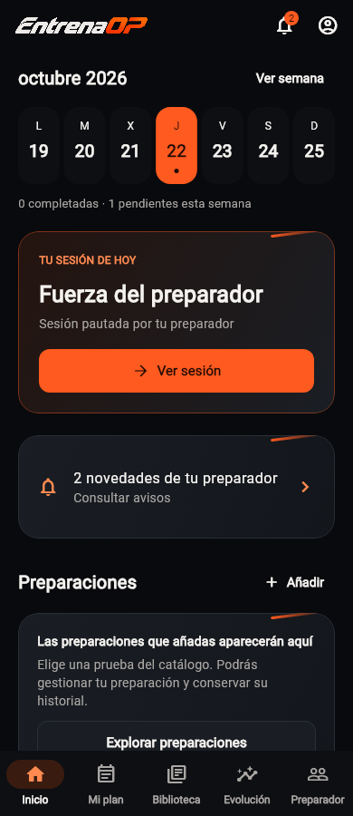
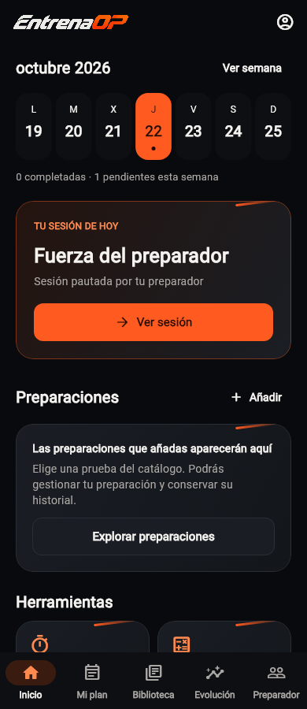

# Navegación del alumno y preparador · TRN-025 · 22/10/2026

## Barra Pulso del deportista · 04/11/2026

En el ancho móvil, Pulso presenta Inicio, Biblioteca, Entrena, Preparador y
Perfil sobre una base mate separada de los bordes. Entrena lleva una pieza
naranja elevada con la silueta OP extraída del logotipo original sobre fondo
oscuro. El archivo conserva el contorno transparente y Flutter lo tiñe para
obtener contraste sobre el naranja. Una raya bajo la sección activa indica
la selección, también cuando el botón central está presente en otra sección.

La barra reutiliza los destinos Material, sus etiquetas accesibles y las
ramas de GoRouter. Entrena abre el centro de entrenamiento. Al volver a una
sección se recupera su pantalla y al pulsar de nuevo la activa se abre su
raíz. Los avisos de Preparador y Perfil conservan sus indicadores propios.
En ancho amplio se usa el rail existente. La versión del deportista es
`1.14.0+32`.

Verificación: análisis limpio, 1.844 pruebas correctas y una omisión previa.
Las 55 comprobaciones dirigidas incluyen rutas y capturas a 320 y 390 px
con texto normal y ampliado. Se comprueba que la pieza central abre Entrena
al tocar directamente el OP y que Biblioteca conserva su rama.

En `1.14.1+33`, el contenido de las cinco portadas se desplaza por detrás de
la barra mate. El margen inferior forma parte del desplazamiento para que la
última acción se pueda llevar por encima de Pulso. El OP sobresale con su
contorno naranja. Los detalles dentro de cada sección reservan el pie de
pantalla para sus acciones.

En `1.16.0+35`, repetir el destino activo lleva arriba la vista vertical
abierta en la portada. Se conserva la cara elegida dentro de Entrena o
Biblioteca. La animación dura 300 ms y se respeta la preferencia de reducir
movimiento. Cambiar de sección recupera la posición que tenía. Desde un
detalle, el destino activo vuelve primero a la portada y la lleva arriba.
El mismo gesto está disponible en el rail de las pantallas amplias.

Verificación del 05/11: análisis limpio y 1.849 pruebas de raíz correctas,
con una omisión previa. Las 38 comprobaciones dirigidas incluyen las
portadas reales, cambio de sección, recuperación de caras interiores,
retorno desde detalle y reducción de animaciones.

La corrección `1.16.1+36` aplica el gesto a Resumen, Agenda, Alumnos y Mensajes
del espacio profesional. Las dos barras usan el mismo controlador de
navegación. Cada espacio registra sus vistas visibles y conserva su estado
al cambiar de sección.

## Preparación, configuración y consulta · 03/11/2026

Implementación UI-067, autorizada tras la [revisión del vídeo y sus fronteras](audits/preparation-flow-review-2026-11-03.md).
Se conservan las pestañas, cards, colores y componentes de la app; no se cambia
el modelo deportivo ni el generador para estabilizar la presentación.

- La portada mantiene la prioridad de revisión/actividad/pausa existente. Si no
  hay ninguna, muestra primero una preparación pendiente y después una finalizada.
  Editar su fecha conserva el orden guardado; consultar otra no activa nada.
- Ficha y plan publicado son consultas de la misma preparación. Alternar no
  acumula copias y conserva la semana, la entrada desde Inicio/Entrenar/Gestionar
  y el retorno. Las respuestas tardías no sustituyen la semana reciente.
- Una única card conduce al plan. Sus acciones distinguen Configurar, Continuar
  configuración, Revisar, Retomar y Cambiar configuración según el estado.
  Pro se comprueba al acceder a la operación existente, sin sustituir su nombre
  por una invitación genérica ni impedir consultar las semanas publicadas.
- Configurar abre una tarea propia; Cambiar configuración entra directamente en
  su editor. No se envía la semana histórica de consulta a `/training`: el flujo
  existente decide la semana de trabajo actual. Aceptar la propuesta vuelve al
  lector canónico del plan cuando hay router, sin añadir otro panel activo.
- Los borradores recuperan el paso visitado por cuenta y objetivo, mediante un
  puerto pequeño y SharedPreferences ya disponible. Solo se guarda la posición;
  los datos reales siguen en sus repositorios. Si faltan fecha o disponibilidad
  confirmada se vuelve al paso correspondiente. Si cambian los pasos disponibles,
  el identificador estable evita confundir Carrera con Movimientos. Una falla de
  preferencias no bloquea configurar. Se limpia la posición al aceptar; activos,
  pausados y finalizados no reabren una posición de borrador antigua.
- Disponibilidad tiene Atrás; la flecha de cabecera retrocede un paso durante la
  configuración. Las guardas existentes siguen protegiendo cambios sin guardar.
- Las marcas objetivo se validan en Movimientos antes de llegar a Propuesta,
  usando las restricciones existentes, con foco visual en el campo incorrecto.
  La referencia por series valida el descanso de 30–600 segundos antes de salir
  de ese paso. Cambiar temporalmente entre una serie y varias conserva el borrador
  de las series; al guardar se envía únicamente el tipo seleccionado.
- Cancelar, cerrar o volver desde una referencia modificada pide decidir sobre
  el borrador. Las operaciones tardías cierran únicamente su propio diálogo.
  Cambiar de cuenta/objetivo retira el diálogo de la página desmontada, incluso
  si existe otra ruta encima, y no conserva sus datos en el nuevo titular.
- Cuenta, objetivo y semana delimitan los controladores. Renovar la misma sesión
  conserva estado; cambiar titular reconstruye la ficha. Catálogo y detalle
  descartan respuestas obsoletas o posteriores a su cierre. Las fechas visibles
  de referencias usan `dd-MM-yyyy`; las rutas y datos conservan ISO.

La continuación automática al refrescar se conserva. No se modifica la prioridad
del generador a partir de combinaciones sintéticas no acreditadas en servidor,
ni se cambia cálculo, dosis, fases, publicación, permisos o límites comerciales.
Esta entrega no constituye una auditoría de eficacia del algoritmo. La aceptación
física requiere compilar e instalar **1.7.0+15** en el iPhone.

Verificación de cierre: `flutter analyze --no-pub` sin incidencias y batería
completa raíz con **1.833 correctas y una omisión previa**. Setenta regresiones
nuevas cubren los fallos y sus fronteras; las pruebas de rutas conservan también
el contrato que impide calcular a partir de una fecha histórica de agenda.
Formato comprobado en los 24 archivos Dart afectados. Capturas de widgets reales
con el tema de la app revisadas a 390 px/texto normal y 320 px/texto doble, sin
desbordamientos; la cabecera larga se abrevia visualmente. Las comprobaciones
Flutter no equivalen a una instalación ni a aceptación física en iPhone.

Comprobación automática de `78fa10b4`: validaciones completas de Trainer y ADMIN
correctas en GitHub, incluidos sus consumidores. El ensayo de Salud compila
Android y la app iOS sin firma correctamente. Ambos paneles Dev publicados y
contrastados por HTTPS: Trainer `0.3.2+8` y ADMIN `0.3.2+7`, con revisión exacta,
SHA-256 del JavaScript e identidad del proyecto `sxbxfjqgoddzhtcyhalw` comprobados.
Estas publicaciones conservan sus versiones: el cambio funcional es del
deportista. No se ha consultado ni modificado producción.

## Reloj · 04/11/2026

Inicio → Herramientas → Reloj abre una utilidad local. El cronómetro cuenta
hacia arriba con dos decimales. Durante la cuenta, Vuelta registra el tiempo
desde la marca anterior sin detener el cronómetro. Los parciales se muestran
del más reciente al más antiguo en el mismo desplazamiento de la pantalla.
Reiniciar borra las vueltas. El temporizador ofrece 30 segundos, uno o dos
minutos y una duración manual con la máscara de reloj de la app (`00:00`).
La opción Preparación añade tres segundos antes de la cuenta principal, con
los avisos de preparación e inicio. Está desactivada al abrir el Reloj y
la fase de preparación admite pausa y reanudación.
Intervalos parte de 20 segundos de trabajo,
10 de descanso y ocho rondas, todos editables. Con descanso cero, las rondas
de trabajo se suceden directamente. El reloj termina con el último trabajo.

Los tres modos admiten pausa, reanudación y reinicio. La acción principal del
Reloj ocupa su propia fila. Vuelta y Reiniciar aparecen debajo como botones
con contorno, icono y espacio entre ellos. La pantalla agrupa el tiempo y el
indicador de fase. Las vueltas alinean el parcial a la derecha con un separador
entre filas. Los avisos existentes
se reutilizan también a mitad de la cuenta atrás y a mitad de cada tramo de
trabajo. En horizontal, el tiempo queda visible a un lado y los controles y
vueltas se sitúan al otro. Girar conserva la cuenta y las marcas. En Android e
iOS la cuenta solicita mantener encendida la pantalla mientras está activa.
Pasar a segundo plano pausa la cuenta y salir de Reloj la descarta. La pantalla
funciona sin ejercicios, sesiones ni almacenamiento de resultados.

## Favoritos, herramientas y presentación · 02/11/2026

El editor de Inicio amplía las opciones existentes y agrupa los destinos en
Entrenamiento, Preparador y Ajustes rápidos. Mantiene Mis sesiones, Mis ejercicios
y Disponibilidad como selección inicial, y permite hasta cuatro accesos ordenados.
Añade Avisos del preparador, Citas, Formularios, Pruebas del preparador, Técnica de
mis sesiones, Notificaciones y Dispositivos y conexiones. No exige escoger un
mínimo ni rellena huecos. Conserva el almacenamiento local por cuenta, los
identificadores anteriores, la cancelación y la recuperación de errores.

Los destinos nuevos reutilizan rutas reales. Avisos cambia a la rama Preparador
con `view=notices`; los detalles se apilan con retorno al origen. Elegir un acceso
no crea un vínculo, no concede permisos ni pauta contenido. Sin contenido se
conserva la pantalla vacía del recurso, y los historiales accesibles siguen sus
contratos existentes.

Ritmos y PAEF/PAFAS permanecen fuera del selector, como confirma Javier. Sus cards
de Herramientas conservan posición y estética. La consulta de un entrenamiento
con bloques de carrera ofrece «Calcular ritmos y parciales», deshabilitado durante
el inicio de la sesión. Marcas y resultados ofrece la calculadora PAEF/PAFAS para
la preparación FAS y Ritmos cuando hay controles de carrera. Son consultas
independientes: volver conserva lo pautado y las marcas, sin iniciar, guardar
resultados ni recalcular el plan por abrir la herramienta.

La versión pasa de `1.0.0+3` a `1.1.0+4`. La versión visible distingue entregas
funcionales y la compilación distingue sus binarios; la regla queda en AGENTS.
Las siguientes correcciones incrementan parche y compilación, las funcionalidades
incrementan menor y compilación. La versión del dispositivo cambia al compilar e
instalar; no se alteran archivos iOS generados ni se inventa una instalación.

El pie de contacto de Privacidad/Condiciones muestra «Equipo de ayuda de
EntrenaOP» con `ayuda@entrenaop.es`. Se retira el apartado Promociones de
Condiciones de uso y la explicación sobre descuentos militares, conservando el
canje de códigos condicionado a un destino configurado en Ajustes.

Las fechas completas visibles se unifican en `dd-MM-yyyy`, incluidos avisos,
agenda profesional, citas, vistas previas, marcas, preparación e historial.
`formatAppDate` permite presentar fechas interpoladas con el mismo criterio.
Javier detecta también el formato inverso en el chat: `ConversationView` mostraba
la fecha técnica con `toString().substring`. Las conversaciones personales y
profesionales usan ahora `formatAppDateTime` (`dd-MM-yyyy HH:mm`), conservando
hora local, orden, paginación, borradores y operaciones de envío. Los dos
formateadores residen en `entrena_ui`; la app reexporta su entrada existente.
Se conserva `es_ES` para los calendarios, los resúmenes cortos día/mes, las horas,
las zonas civiles de las citas y el formato ISO de rutas, repositorios y datos.
No se sustituyen las fechas técnicas por su etiqueta visible.

Verificación focal: 266 pruebas de favoritos, perfil, avisos, citas, marcas,
preparación y consulta de sesiones. Incluye persistencia y límite de cuatro,
compatibilidad con preferencias antiguas, pantalla estrecha con texto doble,
entrada/vuelta de calculadoras y conservación de las rutas ISO.

Verificación final: análisis global sin incidencias, 15 pruebas de rutas e
identidad del perfil y batería completa de raíz con 1.710 correctas y una
omisión previa. Capturas de favoritos y selector revisadas con el tema real.
La ampliación del formato al chat queda incluida en la misma entrega `1.1.0+4`:
12 pruebas del componente compartido, 75 de conversación/espacio profesional,
1.710 de raíz y 444 de Trainer correctas; ambos análisis sin incidencias.

## Ajustes, ayuda y contacto · 02/11/2026

Javier autoriza llevar la propuesta a la app con su diseño y arquitectura.
Perfil conserva identidad, evolución, conexiones y acceso profesional. Ajustes
agrupa **Cuenta y Pro**, **Ayuda** e **Información** mediante EntrenaCard y
ProfileOptionTile, con versión y cerrar sesión al final.

- Mi suscripción conserva el acceso efectivo y las operaciones de prueba que
  ya existían; no concede Pro desde Flutter ni activa compras nativas reales.
- Notificaciones reutiliza StudentPushSettings, sus preferencias y el mismo
  coordinador por cuenta/dispositivo. La ausencia de transporte o servidor se
  indica y se permite volver a comprobar; no se guardan interruptores ficticios.
- FAQ explica Preparación/plan adaptativo, Programas, consulta antes de comenzar,
  pérdida de Pro, preparador y conexiones, con destinos y retorno reales.
- Informar de un problema prepara un `mailto` con texto revisable. El usuario
  elige si incorpora versión, revisión y plataforma; no se adjuntan sesiones,
  conversaciones, identificadores de cuenta ni credenciales. Si no abre el
  correo, conserva el texto y permite copiar contacto/mensaje y reintentar.
  Renovar la sesión conserva el borrador; cambiar de propietario lo descarta.
- Privacidad y Condiciones abren información de la versión de pruebas, también
  desde la oferta Pro y sin iniciar sesión, sin lecturas de datos privados.
  No constituyen un cierre jurídico ni las condiciones definitivas de venta.

**Correo autorizado y creado:** `ayuda@entrenaop.es` es alias de
`javier.charlez@entrenaop.es`, confirmado en el panel de Hostinger y dentro del
plan existente, con uso 1/5 de alias. No requiere otra contraseña. Los MX públicos
apuntan a mx1/mx2.hostinger.com. Esto acredita configuración y encaminamiento,
no una recepción extremo a extremo de un mensaje de prueba. No se enviaron
correos ni se cambiaron DNS, credenciales o suscripciones del alojamiento.

**Fronteras:** AppSupportResources y OpenSupportLink son puertos pequeños;
PlatformAppSupport compone los destinos y el lanzador externo. El router inyecta
ambos, aísla formularios por propietario y abre documentos públicos estáticos.
No se añaden paquetes, tablas, RPC, servicios de tickets ni lógica de Pro local.

**Opciones condicionadas:** APP_INSTAGRAM_URL, APP_RATING_URL y
APP_PROMOTION_REDEMPTION_URL sólo aceptan HTTPS sin credenciales. Vacías ocultan
las filas: no se inventa un perfil social, ficha de tienda ni promoción activa.
La implementación permite conectar esos destinos cuando estén aprobados; el
descuento militar y sus condiciones continúan pendientes en PRODUCT/PRO_LAUNCH.

**Límite de cuenta:** no existe endpoint de baja reutilizable. Hay referencias
restrictivas en clientes/pedidos/recibos, directorio, denuncias y contactos, además
de objetos Storage y datos compartidos. Borrar Auth o preferencias no implementa
la baja. El siguiente bloque de datos debe definir conservación/anónimización,
limpieza de conexiones/Storage/sesiones y suscripción externa, con contrato de
servidor y pruebas aisladas. Un correo no se presenta como eliminación efectiva.

**Comprobación del 02/11:** análisis global limpio, 105 pruebas focales de Perfil,
Pro y router real, y batería completa de raíz con **1.702 correctas y una omisión
previa**. Incluye activación/guardado de recordatorios con el coordinador actual,
FAQ y retorno, soporte vacío/error/reintento/copia/diagnóstico opt-in, renovación
y cambio de cuenta, documentos públicos sin consultas privadas y enlaces desde
Pro a 320 px/texto 2×. Render de Ajustes con fuentes reales revisado; es un widget,
no una instalación iOS. Capturas locales en build/performance_v2_review y prueba
del alias en build/profile_settings_review, fuera de Git. No se han modificado
ADMIN, Trainer, paquetes compartidos, SQL ni producción de las aplicaciones.
La creación del alias del dominio sí corresponde a la petición expresa de Javier.

## Filtro compartido al añadir sesiones · 02/11/2026

«Añadir entrenamiento al día» usa el filtro existente de Biblioteca. Su
composición se extrae a `WorkoutLibrarySearchControls`, que ambas pantallas
consumen sobre `LibrarySearchControls` y `WorkoutLibraryFilter`; no se duplica
la búsqueda ni se crea otra clasificación de sesiones.

Se conservan búsqueda por nombre, descripción y ejercicios, sin distinguir
mayúsculas ni tildes, tipo Fuerza y acondicionamiento/Carrera y los tramos de
duración existentes. El contador, desplegar filtros y limpiar se mantienen.
Mis sesiones y Biblioteca conservan sus grupos después de filtrar. Cabecera,
controles y resultados se desplazan juntos y dejan espacio al teclado.

Filtrar actúa sobre las sesiones ya cargadas; no recarga ni cambia la agenda.
Elegir sigue enviando la plantilla existente al flujo de pautado en la fecha
seleccionada. Se conservan carga, reintento y ausencia real de catálogo, que se
distingue de una búsqueda sin coincidencias. El modelo deportivo, los derechos
y los paquetes compartidos con ADMIN/Trainer permanecen iguales.

Verificación: análisis global limpio, 37 pruebas focales de filtros/Biblioteca/
agenda y batería raíz completa con **1.678 correctas y una omisión previa**.
Incluye combinaciones, búsqueda sin tildes por varios campos, pauta en la fecha
elegida, limpiar, reintento y teclado con texto 2× en pantalla de 320 px.

## Día sin sesiones · 02/11/2026

El vídeo de Javier muestra que seleccionar una fecha vacía en Inicio coloca la
tarjeta del plan guardado donde antes estaba la sesión. Mi semana añade al hueco
un diagnóstico de programa y accesos a activar preparaciones. Se separa el
resumen del día de la gestión del plan con una misma card visual neutral:

- Hoy: **Hoy no tienes sesiones pautadas**. Otras fechas: **No hay sesiones
  pautadas para este día**. No se infiere un descanso ni una nueva pauta.
- Inicio ofrece **Ver mi semana**, conservando la fecha seleccionada, y sólo
  indica una próxima sesión si ya existe en los datos recibidos. Las cards de
  Preparaciones y Entrenar conservan la consulta y gestión del plan guardado.
- Mi semana mantiene **Añadir entrenamiento al día** como acción secundaria
  dentro de la card. Una fecha con sesiones conserva sus tarjetas y el acceso
  flotante existente; no se duplican los accesos a añadir.
- Se conserva la ayuda inicial cuando aún no hay sesiones ni un plan iniciado,
  y la revisión deportiva pendiente cuando el acceso permite atenderla. La
  pérdida de Pro no transforma un día vacío en un aviso comercial.

Es un cambio de presentación: no genera, cancela, reprograma ni inicia sesiones,
y no altera el algoritmo, los derechos Pro ni las pautas del preparador.

Verificación: `flutter analyze` limpio, 45 pruebas focales de Inicio/agenda y
batería raíz completa con **1.676 correctas y una omisión previa**. Incluye Free
con planes en curso/pausados/finalizados/en revisión, navegación con fecha,
sesiones del preparador, continuidad, primer uso y texto 2× a 320 px. Dos casos
de añadir se renderizan con fuentes reales para revisar la card vacía y el
retorno al flotante tras añadir. La instalación de esta revisión se hace desde Mac.

## Entrenar: Preparación, Programas y Disponibilidad · 02/11/2026

Javier aprueba llevar a Flutter el prototipo revisado, corrigiendo el nombre
visible a **Programas**. La implementación conserva la estética de EntrenaCard,
portadas y encuadres, el desplazamiento sincronizado y la barra inferior.

- **Preparación** muestra una sola preparación principal: prevalece el generador
  actual, después el pausado conservado; sin ellos se consulta el primer objetivo
  guardado. Un objetivo nuevo no queda oculto detrás de un plan finalizado.
  Objetivo y plan adaptativo comparten tarjeta. El progreso se obtiene de las
  sesiones reales del algoritmo de esa preparación; no suma sesiones libres ni
  del preparador. La próxima sesión prioriza una ejecución abierta y abre
  **Ver entrenamiento**, con inicio explícito posterior.
- **Gestionar preparaciones** abre `/plan/preparations`: todos los objetivos,
  estados, consulta, marcas y añadir. La portada deja de repetir estas tarjetas
  y la promoción genérica de crear otro plan Pro. Inicio conserva sus cards.
- **Programas** reúne todos los seguidos, incluidas sus páginas de catálogo y
  estados, mediante el Cubit existente. Explorar abre la misma Biblioteca y
  volver conserva pestaña y posición. Se mantienen cuota Free, pausa, historial
  y confirmación editorial del avance de fases.
- **Disponibilidad** conserva días, minutos, material y editor completo actual;
  guardar contexto no activa un programa ni inicia un entrenamiento.
- **Ver semana** abre el calendario común conservando la fecha recibida. Las
  URLs antiguas de Planes/Preparaciones siguen resolviendo a la portada de
  Preparación; `tab=programs` selecciona la nueva cara de Programas.

**Consulta separada del uso:** `/plan/goal/:goalId/plan` lee estado, semanas
publicadas, fases reales y sesiones de esa preparación. También puede abrirse
desde la ficha de objetivo. Free conserva la consulta del plan pausado; retomar
comunica Pro antes de pasar al flujo existente. Consultar nunca calcula, avanza,
publica, activa ni comienza sesiones. La pauta retirada al pausar se recupera de
las decisiones publicadas conservadas con filtros de propietario y RLS. Sus
dosis, descansos, instrucciones, tiempos y cargas se muestran sin prescribir
otros valores, y no tienen acción de inicio. Resultados y pautas vigentes usan
historial y vista previa exacta existentes. Las fases se identifican como estado
actual, evitando atribuirlas retrospectivamente a otra semana consultada.

**Verificación del 02/11:** análisis global limpio, **1.656 pruebas correctas y
una omisión previa** en la raíz. Los casos incluyen router real, Free/Pro,
renovación/cambio de cuenta, semanas, dosis/unidades, pautas de diferente alcance
y retorno con scroll/selección. Se conservan las pruebas de permisos, cuotas,
activación, guardas y ejecutores. [Capturas y límites](visual-audit/athlete-training-2026-11-02/README.md).
El siguiente recorrido físico se registra en ROADMAP. No cambia ADMIN, Trainer, Biblioteca, SQL,
suscripciones, cuotas ni algoritmo. El iPhone requiere compilar e instalar esta
revisión desde Mac; las pruebas locales no acreditan esa instalación.

## Rectificación: la preparación adaptativa es la entrada principal · 02/11/2026

Javier corrige la propuesta siguiente: el valor principal de EntrenaOP es el
plan/preparación con algoritmo que ajusta el entrenamiento del deportista sin
depender de un preparador. Las rutinas repetibles y los programas por fases son
otro recorrido. La propuesta de agruparlos como una oferta indiferenciada y
relegar las preparaciones queda descartada. Esta prioridad coincide con PLAN y los contratos
del motor; PRG-001/002 incorpora guiados, no redefine el núcleo del producto.

La revisión de documentación y código confirma:

- Preparación es el objetivo personal con fecha, pruebas y marcas. Su plan añade
  alcance, referencias, metas, activación y evolución; no son dos catálogos hermanos.
- Pueden guardarse varias preparaciones, con un único generador adaptativo activo
  por deportista. Cambiar de preparación generadora requiere revisar la propuesta
  y pausar la anterior; la presentación no debe activar nada por sí sola.
- Después de activar, resolver las sesiones pendientes permite calcular y publicar
  la continuación con los resultados disponibles. El motor puede mantener,
  reducir o solicitar revisión. La continuidad no exige publicar manualmente cada semana.
- Una rutina guiada puede repetir circularmente sus sesiones sin duración total.
  En Por fases, el autor publica instrucciones y duración orientativa; el usuario
  confirma el avance. Actualmente no existe en ese modelo una regla que mida la
  mejora y cambie automáticamente de fase. Esa automatización sería otro trabajo
  deportivo, no una modificación de navegación.

La recomendación revisada es abrir Entrenar por **la preparación y su plan**:
estado, siguiente acción, entrenamiento pautado y evolución del plan en un único
contexto. Otras preparaciones se gestionan desde ahí sin repetir la misma tarjeta
como otro plan. Los guiados seguidos conservan una entrada diferenciada; Biblioteca
mantiene catálogo, consulta y creación. La semana sigue siendo la agenda común y
Disponibilidad el contexto compartido. Los nombres y pestañas exactos todavía
son una propuesta, no una implementación aprobada.

Se conservan los hallazgos de duplicidad de abajo y el acceso legítimo a planes
pausados o históricos, pero su corrección debe respetar esta prioridad. Este
tramo sólo corrige diagnóstico y documentación; no cambia Flutter ni el motor.

## Entrenar y Biblioteca: revisión del modelo · 02/11/2026

Javier informa de una cuenta Free con plan automático pausado, consulta del
programa y acceso Pro al intentar utilizarlo. Describe el mismo plan de nuevo en
Preparaciones, otra preparación pendiente y una promoción adicional para crear
un plan adaptativo. Cuestiona también las entradas a los guiados desde Entrenar
y Biblioteca. Reabre la organización conceptual; todavía no aprueba otro reparto.

Comprobado en el código directamente relacionado:

- Planes muestra todos los programas adaptativos cuyo estado no sea `draft`,
  incluidos pausados y completados; no es una lista exclusiva de programas en curso.
- Preparaciones vuelve a componer cada objetivo con el progreso del mismo programa.
- La promoción Pro aparece si no hay un programa `isCurrent`, por lo que un
  pausado puede coexistir con una invitación genérica a crear otro.
- Añadir en Tus programas guiados ya abre `/library?tab=programs`: hay una entrada
  alternativa al mismo catálogo, sin una segunda colección independiente.
- Biblioteca contiene Programas, Sesiones y Ejercicios, incluidas las plantillas
  personales reutilizables. No equivale al calendario ni a las sesiones pautadas.

La primera propuesta mantenía Biblioteca para explorar y crear contenido y hacía
de Programas la portada de Entrenar. Javier corrige su jerarquía: ese planteamiento
queda sustituido por la preparación adaptativa como entrada principal, según la
rectificación anterior. Se conserva la separación catálogo/seguimiento, el acceso
a la agenda común y la necesidad de evitar tarjetas y promociones duplicadas.

El requisito Pro se comunica antes de intentar activar o retomar el plan, sin
borrar ni ocultar la consulta legítima de lo conservado. Se recomienda una entrada
contextual al plan personalizado, evitando promociones genéricas repetidas junto
a un plan ya existente. Cambiar la presentación no cambia sus derechos comerciales.

La afirmación de poder añadir cualquier cantidad de guiados no se ha contrastado
en la cuenta: explorar no equivale a tener varios activos. COM-019/020 conserva
un programa guiado activo en Free y varios en Pro, con pausa e historial. Una
activación simultánea incompatible sería una incidencia separada que requiere
verificar el estado real, no una razón para modificar cuotas durante este rediseño.

## Revisión de Perfil y acceso profesional · 01/11/2026

Tras probar el reparto implementado, Javier rechaza la presencia del selector
Personal/Entrenador en la cabecera. Pide un acceso más discreto o trasladarlo a
Perfil, recuerda que la denominación visible es preparador y reabre la relación
entre Perfil y Ajustes. Esto revisa el criterio visual del selector aprobado
antes. Javier autoriza implementar la propuesta con una corrección expresa:
Dispositivos y conexiones permanece a mano en Perfil.

Se ha inspeccionado el vídeo aportado, de 26,92 segundos. Su Perfil conserva la
identidad y el historial; un engranaje abre Ajustes, donde se agrupan cuenta,
soporte, información legal y opciones de la aplicación. No se propone copiar sus
mensajes comerciales, restablecimientos ni funciones que EntrenaOP no tenga.

El código actual mezcla en Perfil identidad, edición de nombre y nacimiento,
evolución, conexiones, suscripción, versión y salida. El selector profesional se
compone por encima del shell y ocupa una franja adicional en las pantallas
principales de las cuentas habilitadas. Este es el diagnóstico comprobado.

El reparto autorizado es:

- Conservar **Perfil** en la barra: identidad compacta, acceso a editar datos y
  protagonismo para Mi evolución. La información deportiva no se oculta en Ajustes.
- Mantener **Dispositivos y conexiones** como acceso directo en Perfil, sin
  introducir un paso por Ajustes para Salud del móvil, Apple Watch o Garmin.
- Abrir **Ajustes** desde un engranaje en Perfil para suscripción,
  opciones de cuenta, información de la app y cerrar sesión. Se reutilizan los
  recorridos existentes; no se añaden opciones sin funcionamiento.
- Sustituir la franja global por una fila discreta **Entrar como preparador** en
  Perfil, visible sólo para cuentas habilitadas. Entrar requiere dos toques desde
  una sección personal; el espacio profesional ofrece **Volver a mi entrenamiento**
  y conserva su última pantalla. Se utiliza preparador en los textos visibles.
- Conservar los avisos del preparador recibido en la pestaña Preparador. Los de
  deportistas propios se identifican en el acceso profesional; un indicador en
  Perfil permite advertirlos desde otras secciones sin recuperar la franja global.

El coste de esta recomendación es perder el cambio profesional en un único toque
desde cualquier sección personal. La ganancia es recuperar espacio de contenido
y separar la actividad personal del trabajo profesional. El cambio no concede
permisos, modifica datos ni altera avisos, lecturas o procesos deportivos.
Se verifican entrada, retorno, borradores y cuentas con y sin acceso profesional.

### Implementación y comprobación del ajuste

`/profile/edit` y `/profile/settings` son tareas raíz con retorno al origen y
alternativa a Perfil en entrada directa. Editar conserva nombre y nacimiento;
la foto sigue editable en el avatar de portada, con el mismo control y sus
reintentos. Perfil no consulta nacimiento. La renovación transitoria de la misma
cuenta conserva identidad, foto y consultas; una cuenta distinta descarta sus
estados anteriores. El texto ampliado utiliza tarjetas adaptables a ancho completo.

El acceso profesional conserva la última sección personal distinta de Perfil y
la pila profesional, incluidos chat, agenda y borradores. Si se accede directamente
al espacio profesional, el retorno lleva a Perfil. El retorno también permanece
disponible durante la comprobación inicial de acceso; nunca monta datos privados
antes de verificar autorización y MFA. Los diálogos de salida y los envíos en
curso conservan sus guardas en la primera y en las siguientes salidas de una rama.

Análisis final limpio. Baterías completas: deportista **1.623 correctas y una
omisión previa**, ADMIN **368 y dos omisiones previas**, Trainer **432** y
`entrena_ui` **64**. Se reproducen las regresiones antes de corregir el registro
de guardas y la sustitución de conversaciones. Las ocho comprobaciones visuales
producen nueve capturas reales de Perfil, Ajustes y edición, a 320/390 px y texto
1×/2×, en `visual-audit/profile-workspace-2026-11-01/`; incluyen acceso profesional
y su contador. Las etiquetas se leen sin partir palabras; el correo largo se
divide para conservarlo completo. El generador sigue siendo
`tools/athlete_navigation_visual_test.dart`, con `ATHLETE_CAPTURE_DIR` para elegir
la carpeta. Son datos ficticios y no acreditan instalación en iPhone.

## Reorganización aprobada · 01/11/2026

Javier aprueba implementar el reparto revisado, conservando la estética y los
procesos que funcionan. Esta sección sustituye las propuestas y posiciones
históricas descritas más abajo.

| Destino inferior | Recorrido implementado |
| --- | --- |
| Inicio | Calendario compacto, sesión del día, preparaciones, guiados, herramientas y favoritos existentes; tarjeta compacta de novedades. |
| Entrenar | Planes como primera cara; desplazamiento sincronizado por toque o gesto entre Planes, Preparaciones y Disponibilidad. Ver semana abre el calendario común. |
| Biblioteca | Catálogo, consulta y creación existentes. Cambia únicamente la cabecera compartida de navegación. |
| Preparador | Búsqueda, conversaciones, recursos, avisos y gestión/historial del vínculo. Indicador de novedades en la pestaña. |
| Perfil | Identidad compacta, Mi evolución, Dispositivos y conexiones, acceso profesional y engranaje de Ajustes. |

### Contratos conservados

- Se mantienen las URLs de agenda, resultados, preparaciones, dispositivos y
  tareas profesionales. Perfil ocupa la rama histórica 3 junto a Evolución;
  `/profile` es su entrada y `/assessment/history` conserva sus hijos. La barra
  presenta las ramas `[0, 1, 2, 4, 3]`; el trabajo profesional permanece en la 5.
- Cambiar de sección conserva su pantalla y volver a tocar la entrada activa
  recupera su raíz. La revisión posterior sustituye el selector superior por el
  acceso profesional en Perfil y mantiene la memoria de los espacios. Los
  borradores siguen protegidos por las guardas existentes.
- Entrenar recibe opcionalmente `tab` y `date`; Ver semana utiliza la fecha
  correspondiente. El editor `/profile/preferences` conserva días, minutos,
  material, validación y guardado. El alias `/plan/preferences` sigue funcionando.
- Planes muestra los automáticos iniciados, pausados y finalizados con estado
  explícito. Los programas guiados seguidos utilizan el catálogo completo
  existente, sin heredar el límite de tres del resumen de Inicio. Preparaciones
  conserva objetivos, pruebas y configuraciones pendientes.
- El contador de Preparador utiliza el total del servidor, independiente de la
  página o filtro. Abrir la sección no confirma lecturas. La recepción, resolución
  y confirmación de avisos conservan sus contratos. Los avisos profesionales se
  mantienen separados en el espacio de preparador; se retira la campana superior personal.
- La búsqueda de preparadores sigue accesible sin recursos. Un error no se
  interpreta como ausencia de vínculo ni borra historial. La presentación vacía
  ofrece búsqueda e historial tras una respuesta confirmada.
- Perfil se fija a la identidad: renovar la misma sesión conserva su estado y
  cambiar de cuenta sustituye sus consultas pendientes. Volver de una tarea
  refresca los datos personales como antes.

### Consulta del entrenamiento antes de empezar

Javier confirma después que la consulta completa es imprescindible y autoriza
cerrarla en el mismo recorrido. La card y Ver entrenamiento abren la pauta
exacta, sin empezar. La acción de inicio es explícita y conserva el ejecutor,
comprobando que no se sustituya por contenido cambiado después de consultarlo.
Esta ampliación sustituye el límite inicial que dejaba únicamente metadatos.
No cambia reglas deportivas ni concede acceso al programa privado completo.
[Contrato y validación de la vista previa](SCHEDULED_WORKOUT_PREVIEW_2026_11_01.md).

### Comprobación y distribución

`flutter analyze` queda limpio. La batería completa de raíz termina con
**1.577 pruebas correctas y una omisión previa**. Incluye identidad, respuestas tardías, Perfil/Evolución, enlaces
históricos, retorno del editor con borrador y fecha, catálogo seguido completo,
lectura explícita de avisos, inicio por botón y cambio profesional conservando
pantalla y borradores. El editor de nombre permite desplazarse en el diálogo
para conservar sus controles a 320 px con texto 2×.

Las **14 comprobaciones visuales** generan 15 capturas de widgets reales con
datos ficticios y sin red; se reproducen con
`tools/athlete_navigation_visual_test.dart` y se guardan en
`visual-audit/athlete-navigation-2026-11-01/`. Cubren Inicio, las tres caras de
Entrenar, Perfil, Preparador y selector profesional, incluidos 320 px y texto 2×.
La revisión visual incluye correcciones del espacio disponible para identidad y
Evolución y del contador profesional junto a su etiqueta. No acredita instalación
de esta versión en el iPhone: requiere recompilar e instalar desde Mac.

El único siguiente bloque recomendado es aceptar en iPhone la semana de Inicio,
el gesto entre las tres caras, editar Disponibilidad y volver, los avisos del
preparador y el cambio profesional desde Perfil con una pauta de Ervi.

## Revisión global abierta · 01/11/2026

Javier indica que la incoherencia alcanza más recorridos y botones que los dos
ejemplos de la revisión transversal. El acceso a Perfil en la cabecera no le
gusta y se reabre su ubicación. La elección del 22/10 describe la implementación
actual y el acuerdo anterior; ya no debe interpretarse como aceptación definitiva
de la posición superior de Perfil.

El código actual confirma solapamientos: Perfil incluye preparaciones,
herramientas y Mi preparador; el hub Preparador y la gestión del vínculo ofrecen
accesos a formularios y conversación; Inicio y Mi plan presentan semana y
preparaciones. Mi plan utiliza como primera referencia el programa automático
aunque las pautas profesionales también sean el entrenamiento del usuario.
En las cuentas profesionales, el selector superior añade además el acceso al
trabajo con alumnos propios. El código separa esos espacios, pero hay que revisar
si esa diferencia se entiende en la interfaz.

### Propuesta visual pendiente de revisión con Javier

Repartir las tareas entre cinco entradas inferiores, con un destino principal
por tarea. Los accesos contextuales pueden llevar a ese mismo destino conservando
fecha, pauta y origen; no deben crear otro resumen independiente.

| Entrada propuesta | Contenido principal |
| --- | --- |
| Inicio | Conservar calendario, cards de preparaciones, programas y herramientas; revisar su orden. Sesión del día y tarjeta compacta de novedades del preparador. |
| Entrenar | Calendario personal común y accesos internos a planes, preparaciones y disponibilidad. El origen distingue pautas del preparador, automáticas y personales. |
| Biblioteca | Descubrir, consultar y crear sesiones y ejercicios; programas guiados. |
| Preparador | Personas con quienes se entrena, conversaciones, formularios, citas y gestión de vínculos. Las pautas abren el calendario personal común. |
| Perfil | Probar Evolución junto a identidad, foto, cuenta, preferencias, conexiones, suscripción y ajustes. |

Esta propuesta devuelve Perfil abajo y retira su acceso repetido de la cabecera.
Evolución deja de ser una entrada inferior independiente y se prueba dentro de
Perfil, a sugerencia de Javier. Sustituye la primera propuesta de alojarla en
Entrenar. Mantendría accesos contextuales desde resultados. La distribución y
los nombres continúan pendientes de aceptación.

### Referencia visual y ajuste de la propuesta · 01/11/2026

Javier descarta la simplificación visual de Inicio del primer prototipo: quiere
conservar sus cards y su identidad. Valora la idea de pendientes, pero recuerda
que la tarjeta actual de novedades del preparador ya cubre parte de esa función.
El prototipo revisado conserva esa tarjeta compacta y recupera calendario,
preparaciones, programas seguidos y herramientas, sin añadir otro resumen de
pendientes equivalente.

El vídeo aportado muestra una barra inferior estable y, dentro de Correr, una
fila horizontal de accesos que abre páginas con retorno. También permite
desplazar semanas. La referencia justifica explorar esos dos niveles de
navegación; no implica unir Mi plan y Preparador, que Javier señala como asuntos
distintos, ni sustituir la estética de EntrenaOP.

La propuesta interactiva prueba esa fila dentro de Entrenar: Mi semana, Mis
planes, Preparaciones y Disponibilidad. La semana reúne las sesiones fechadas;
Mis planes permite distinguir el plan automático y los programas guiados que se
siguen; Preparaciones reúne los objetivos y sus pruebas. Preparador conserva la
relación, conversación y seguimiento. Biblioteca permite descubrir contenido;
seguir un programa tiene su acceso principal en Mis planes. Los accesos desde
Inicio llevan a esos mismos destinos conservando el origen.

Los programas del prototipo son ficticios. Este reparto no concede al deportista
acceso al programa privado completo de un profesional: se mantiene el contrato
de sesiones asignadas. Tampoco modifica niveles de suscripción ni permisos.

La propuesta se revisa con datos de ejemplo, fila horizontal, cambio de semanas,
detalle de sesión y Evolución en Perfil; no modifica rutas ni pantallas de
Flutter. La aceptación de estos recorridos precede a su implementación.

### Impresiones del segundo prototipo · 01/11/2026

Javier valora la dirección visual y concreta estos criterios para la siguiente
revisión, todavía sin autorizar su implementación en Flutter:

- Conservar la semana compacta de Inicio. Repetirla como primera cara de
  Entrenar resulta redundante, aunque el calendario completo debe seguir
  accesible.
- Mantener Planes, Preparaciones y Disponibilidad como apartados internos y
  explorar el desplazamiento del contenido sincronizado con sus accesos.
- Reutilizar la presentación y el editor actuales de disponibilidad y material;
  la simplificación del prototipo no sustituye días, minutos, material ni sus
  reglas de guardado.
- Conservar Biblioteca como está durante este bloque.
- Preparador debe ofrecer búsqueda cuando no existe vínculo y mostrar en su
  pestaña el indicador de novedades, en lugar de depender de la campana superior.
- Perfil sigue la dirección deseada. El cambio al trabajo profesional necesita
  conservar la rapidez del selector actual; enterrarlo en Perfil añade pasos.
- El alcance es presentación, ubicación y continuidad de navegación. Se
  conservan los procesos deportivos, datos, permisos y la arquitectura existente.

La recomendación pendiente de Javier es abrir Entrenar en Planes, con
Preparaciones y Disponibilidad como las otras caras del desplazamiento. Un
acceso visible a Ver semana abriría el calendario existente, compartiendo destino
y fecha con el acceso desde Inicio. Así se mantiene su función de agenda sin
repetir el resumen semanal como portada de dos secciones.

Se recomienda conservar el selector de espacio visible en las pantallas
principales, con una presentación más ligera que respete el tamaño de texto y
recupere el destino anterior. Los avisos recibidos del preparador pertenecen al
espacio personal; los de alumnos propios, al profesional. Mover el indicador no
debe alterar recepción, autorización ni confirmación de lectura. Las pruebas
deben cubrir retorno, fecha, borradores y cuentas con y sin seguimiento.

El trabajo con alumnos propios mantendría un espacio profesional con agenda,
alumnos y mensajes. Su entrada y retorno deben ser explícitos y conservar el
contexto. «Mi preparador» describe el servicio que recibe la persona;
«Espacio de entrenador» describe su actividad profesional. La posición final
del cambio de espacio sigue abierta, especialmente por la frecuencia de uso.

Revisar después los botones con la misma regla: tocar una sesión permite
consultar su receta; empezar requiere una acción explícita. Este comportamiento
se propone y todavía no está implementado. Cada pantalla debe distinguir su
acción principal de editar, añadir, gestionar o configurar.

El siguiente paso es validar el reparto con los recorridos de un usuario sin
preparador, un alumno con pautas y una cuenta que también trabaja con alumnos.
La implementación transversal comienza después de concretar esa estructura.
Esta revisión documental no modifica Flutter, datos, permisos ni rutas.

## Elección del 22/10 e implementación actual

Preparador abajo, Perfil arriba e Inicio despejado. La campana se oculta por
completo con cero avisos sin leer, para que no parezca un control de sonido.
Mantener avisos, historial y las planificaciones coexistentes. Sin agentes ni
coordinación con otros chats.

## Implementación

- El shell conserva Inicio, Mi plan, Biblioteca y Evolución. Añade Preparador
  ante vínculos actuales/anteriores o recursos/avisos profesionales propios.
  No muestra una quinta pestaña comercial o vacía a usuarios sin seguimiento.
- Perfil sale de las ramas inferiores y conserva `/profile`, preferencias,
  vínculo y actividades como rutas raíz. El icono superior abre Perfil con
  retorno al origen; una entrada directa puede volver a Inicio.
- Los cuatro destinos y Preparador incorporan el mismo acceso superior a Perfil
  y la campana condicional. La campana abre `/my-trainer?view=notices`.
- Inicio conserva entrenamiento, calendario, preparaciones y contenido general.
  Sustituye las tarjetas profesionales repetidas por una tarjeta compacta con el
  total de novedades del servidor. Sin novedades, tampoco aparece esa tarjeta.
- Preparador separa Resumen y Avisos. Resumen conserva sesiones, formularios,
  conversación, pruebas y técnica cuando existen, y siempre permite consultar
  vínculo e historial, incluso sin recursos. Avisos conserva filtros, paginación,
  destino autorizado y confirmación explícita de lectura.
- Se mantienen las URLs de formularios, conversación, técnica y agenda. Las
  tareas continúan sin barra cuando corresponde. No cambia el ejecutor ni la
  convivencia del plan automático con pautas profesionales.

## Carga e identidad

`StudentNavigationController` comparte el resumen de avisos entre cabecera,
Inicio y pestaña. Consulta vínculos mediante el repositorio existente; solo busca
los terminados si no hay uno activo. No descarga respuestas, vídeos ni todas las
páginas del historial para decidir si mostrar una pestaña.

Agrupa refrescos simultáneos y actualiza al reanudar, refrescar Inicio o volver
de gestionar el vínculo. El hub incorpora sus nuevos totales tras consultar o
marcar avisos. Una respuesta antigua no revierte una lectura posterior. Un fallo
de conexión conserva lo ya conocido en esa sesión; no simula que no quedan
avisos. No hay sondeo continuo ni nueva sincronización en segundo plano.

El estado pertenece a una identidad y se descarta al cambiar de cuenta o salir.
La renovación transitoria de sesión conserva las ramas, sus filtros y scroll;
la prueba existente de Evolución detectó y permitió corregir esa regresión.
La visibilidad de navegación no concede permisos: los destinos siguen validando
sus recursos en servidor.

## Comprobación

- Pruebas focales de shell, rutas, avisos e identidad correctas; incluye volver
  de Resumen a Avisos y seleccionar Preparador desde la campana.
- Seis pruebas de rutas de Evolución correctas tras la corrección de renovación.
- Batería completa final de raíz: **1.270 correctas, una omisión previa**.
- Análisis focal y análisis global final de Flutter limpios, incluido el
  generador de capturas. Los avisos temporales de trabajo ajeno observados durante
  el desarrollo ya no aparecen en el análisis final.
- Cinco escenarios visuales con widgets reales, datos ficticios y sin red:
  Inicio con/sin avisos, 320 px con texto 2×, Preparador e historial sin recursos.
  `tools/athlete_navigation_visual_test.dart` los reproduce. Perfil se comprueba
  accesible en cabecera y la campana ausente a cero.

No cambia ADMIN, creadores compartidos, dependencias, Supabase ni producción.
No implementa push ni pagos. Este cambio es de la app del deportista y no requiere
publicar otra vez `trainer.entrenaop.es`.

## Distribución y siguiente paso

Pruebas y capturas no acreditan instalación en el iPhone. El siguiente paso es
compilar e instalar la revisión nueva y aceptar inicio, campana, pestaña,
conversación e historial con la cuenta vinculada. Los otros pendientes de los
dieciséis puntos mantienen su estado en `TRAINER_STUDENT_UX_2026_10_22.md`.

