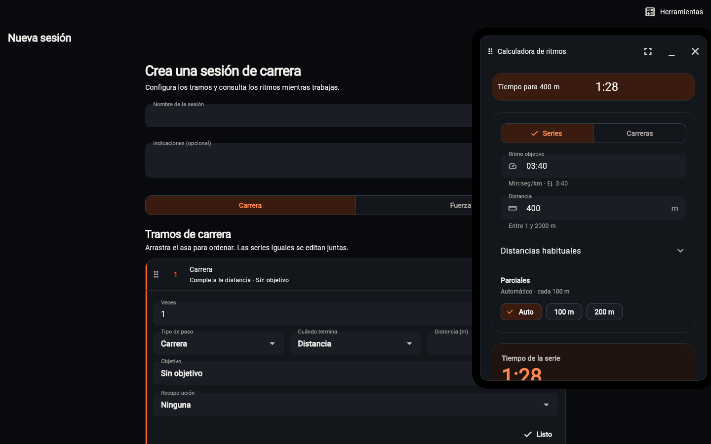
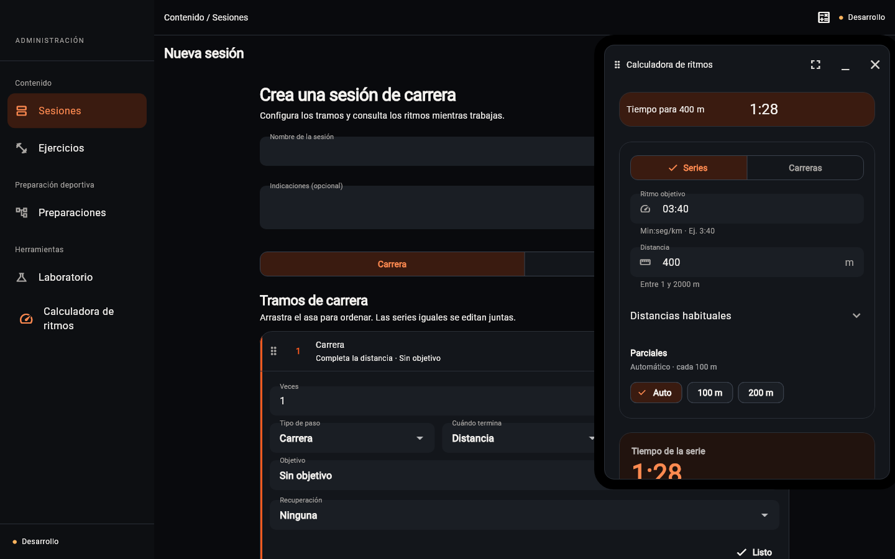
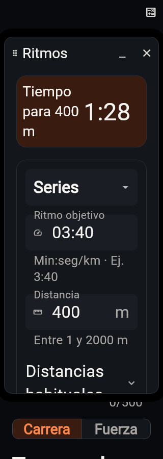

# Herramientas profesionales · TRN-027 · 24/10/2026

Javier pide usar la calculadora de ritmos mientras trabaja en Trainer y ADMIN,
en una ventana que pueda desplazar sin abandonar el editor ni perder el borrador.
El cambio no modifica grupos, autoría de sesiones, permisos ni asignaciones.

## Implementación

- `workout_core/running_pace_calculator.dart`: misma aritmética de ritmo,
  tiempo objetivo y parciales, con las validaciones y el redondeo existentes.
  La ruta anterior del dominio del deportista reexporta esta implementación.
- `workout_editor_ui/running_pace_calculator_view.dart`: única interfaz de Series
  y Carreras; conserva distancias, unidades y cálculo inverso. El deportista
  mantiene su página y navegación. En los portales se omite el texto introductorio
  para reservar espacio a los controles y resultados.
- `entrena_ui/floating_tool_workspace.dart`: ventana no modal con movimiento
  por cabecera o flechas del teclado, tamaño ampliado, minimización y cierre.
  Se limita al área visible y se recoloca al estrechar la pantalla o abrir teclado.
- `workout_editor_ui/professional_tools_workspace.dart`: composición compartida
  y menú Herramientas → Calculadora de ritmos.

ADMIN ofrece Herramientas en su cabecera. Trainer lo ofrece en la barra lateral;
en pantallas estrechas, en Más, y dentro del creador en una franja de herramientas.
Ambos alojan la ventana junto al navegador del área autorizada, conservando sus
campos al navegar y minimizar. Abrirla de nuevo restaura la misma instancia;
cerrarla descarta su cálculo temporal. Salir del área o cambiar de cuenta desmonta
el contenedor. No se persisten datos ni se consulta el servidor para calcular.
Los diálogos del editor conservan prioridad sobre la herramienta.
ADMIN incluye además la entrada directa en su apartado lateral Herramientas.
El resultado resumido permanece visible arriba mientras se desplazan los campos
y parciales; las distancias habituales se despliegan bajo demanda. En pantallas
estrechas con texto ampliado, Series/Carreras usa un selector que evita partir
las palabras. La página del deportista conserva su presentación anterior.

## Verificación y publicación

Análisis raíz, ADMIN y Trainer limpios. La batería raíz pasa 1.330 pruebas con
una omisión preexistente. ADMIN pasa 315 pruebas con dos omisiones preexistentes;
tras añadir el acceso lateral se contrastan también sus nueve pruebas de
contenedor/herramientas y una omisión visual existente. Las regresiones finales
de ritmos, ventana y capturas suman 43 pruebas correctas, sin errores de layout
en escritorio ni a 320 px con texto 2×. El cálculo extraído se compara con el
anterior y coincide sin cambios de aritmética.

Durante la comprobación aparecen cambios ajenos en curso en el informe del
alumno y sus pruebas, con fallos en esa parte de la batería compartida. Se
conservan intactos y se contrasta esta entrega en una copia temporal del árbol
preparado: main más únicamente sus archivos, sin crear ramas ni worktrees.
Trainer pasa allí sus 184 pruebas y el análisis. No se acredita como limpia la
copia de trabajo compartida ni se incluyen las modificaciones ajenas.
Compilación web release Dev correcta desde esa copia validada, con CSP, recursos
locales y sin mapas de fuentes. El servidor profesional no se actualiza por compilar.

Capturas de widgets reales con datos ficticios y sin acceso de red:

La publicación de Trainer sigue pendiente: el acceso de navegador y el control
de aplicaciones alternativo no arrancan por un error de volumen de red del
runtime (`T:`, error 64). No hay transporte de publicación profesional configurado
en el entorno. No se solicita cambiar permisos ni se presenta el paquete local
como publicado. ADMIN conserva su flujo automático Dev al subir fuentes a main;
su activación y versión servida se deben contrastar después del push.
La colaboración entre varios preparadores continúa únicamente documentada.
