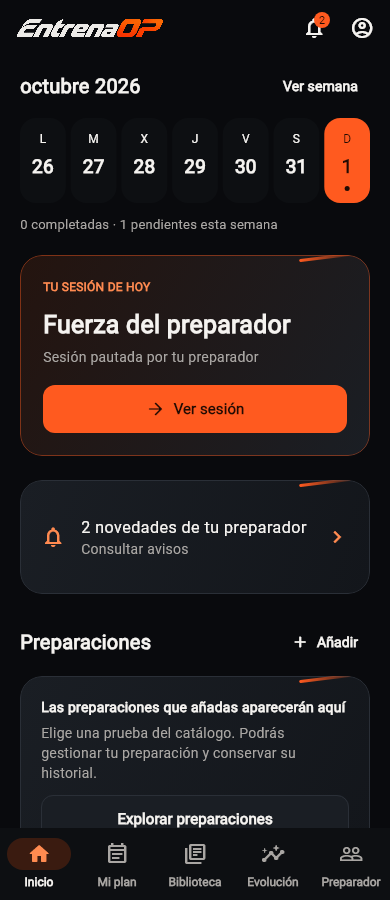
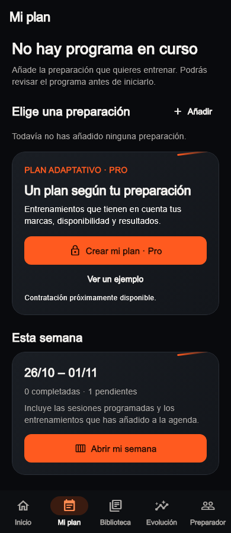

# Revisión de EntrenaOP a 1 de noviembre de 2026

La prioridad recomendada es estabilizar y simplificar el recorrido del deportista.
La base técnica de las tres aplicaciones está consolidada, pero hay pérdidas de
contexto y dependencias de carga que las pruebas actuales no impiden. Trainer y
ADMIN necesitan arreglos localizados; la web comercial sigue siendo una propuesta
local con varios pasos pendientes antes de compartirla con usuarios.

Esta revisión no aprueba un rediseño, cambios comerciales o nuevos contratos. Las
propuestas siguientes deben concretarse con Javier antes de cambiar la navegación
global. Se conservan las decisiones vigentes sobre Preparador, Perfil, permisos y
convivencia de las pautas profesionales y automáticas.

## Estado contrastado

Revisión sobre `main`, commit `c08e297188bb5239ed33f102b7ee96a872d8e8b4`.
Árbol inicialmente limpio y `HEAD` coincidente con `origin/main` tras descargar
referencias. Tres agentes revisaron ADMIN, Trainer y web; el recorrido del
deportista y la consolidación se revisaron en el chat principal.

| Frente | Estado comprobado | Prioridad |
| --- | --- | --- |
| Deportista | Entrenamiento, agenda, biblioteca, preparaciones, evolución y seguimiento disponibles; análisis limpio y 1.553 pruebas correctas, una omisión previa. | Sesión del día accesible aunque fallen servicios secundarios y orientación clara para alumnos sin algoritmo. |
| Trainer | Cartera, planificación, resultados, chat, editores y gestión profesional; análisis limpio y 424 pruebas correctas. | Conservar fecha y programa al cambiar de paso. |
| ADMIN | Autoría, revisión, acceso, recuperación, papelera y diagnóstico; análisis limpio y 368 pruebas correctas, dos omisiones previas. | Reintento de paginación y recuperación de calentamientos. |
| Web | `website/dist` contiene «En construcción»; `website/next` contiene la propuesta comercial local. Repositorio independiente limpio, `main`, `98d58bf`, sin remoto. | Definir el siguiente paso del deportista y actualizar la información antes de publicar. |
| Supabase Dev | Proyecto `entrenaop-dev` activo y saludable; las 268 versiones remotas coinciden exactamente con los archivos locales. | Mantener controles y revisar avisos de seguridad de forma acotada. |

Las baterías y capturas acreditan código y escenarios simulados. Esta revisión no
incluye una nueva aceptación física iOS/Android, recepción de push, ejecución
deportiva real, cobro real, comprobación del alojamiento web o despliegue. No se
consultó producción ni se ejecutó toda la batería SQL transaccional. La comparación
de migraciones se hizo mediante el conector de Supabase, no mediante la CLI.

## Deportista

**Seguimiento del 01/11/2026:** Javier autoriza corregir únicamente el bloqueo
por catálogo mientras comprueba las propuestas de Mi plan y consultar/empezar.
La corrección separa la carga de sesiones y la del selector, con reintento local.
[Contrato actualizado](UX_REVIEW_2026_10_09.md#agenda-independiente-del-catálogo--01112026).
El hallazgo siguiente describe el comportamiento de la revisión original.

### La biblioteca puede impedir ver una agenda válida

**P2, defecto reproducido.** La primera carga de `WorkoutScheduleCubit.load`
espera secuencialmente a programas, agenda, biblioteca pública y biblioteca propia.
Solo después publica las sesiones. En una prueba local con una sesión válida y
fallo de la biblioteca pública, la agenda terminó en `failure`, `hasLoaded=false`
y sin sesiones visibles. No es una hipótesis de latencia: un fallo secundario
basta para bloquear la consulta principal. Tras una carga previa se conservan
los datos anteriores, por lo que el impacto más claro es la primera apertura.

Evidencia: [carga de la agenda](../lib/features/workout_schedule/presentation/bloc/workout_schedule_cubit.dart#L42)
y [pantalla de error inicial](../lib/features/workout_schedule/presentation/pages/workout_schedule_page.dart#L99).
El resumen de Inicio/Mi plan también depende de la recuperación del programa y de
las evaluaciones antes de entregar un resultado compuesto:
[GetPreparationOverviewUseCase](../lib/features/dashboard/domain/usecases/get_preparation_overview_usecase.dart#L42).
El coste de esas dependencias está comprobado; la latencia percibida en un móvil
real queda por medir.

Recomendación: separar la disponibilidad de las sesiones de la carga del selector
de biblioteca y mostrar sus errores en su propio contexto. Mantener la recuperación
del programa y su orden contractual, sin convertir un fallo en ausencia ficticia
de plan. Cubrir agenda válida con catálogo caído y recuperación posterior.

### Mi plan prioriza el algoritmo aunque el alumno tenga pauta

**P2, fricción reproducida con widgets reales.** Un alumno sin preparación
automática y con una sesión de su preparador ve primero «No hay programa en
curso», «Elige una preparación» y una tarjeta Pro. Su semana con la sesión
aparece después. El texto se refiere correctamente al algoritmo, pero el nombre
«Mi plan» invita a entenderlo como ausencia de entrenamiento.

Evidencia: [composición del hub](../lib/features/training_plan/presentation/pages/training_hub_page.dart#L216).
Las dos capturas usan datos ficticios, una misma sesión profesional y ninguna
preparación automática; no representan cuentas reales.

| Inicio del alumno | Mi plan del mismo caso |
| --- | --- |
|  |  |

Recomendación: priorizar la semana ya pautada y presentar «Programa automático»
como una capacidad específica, con su estado propio. Mantener el acceso a Pro y
a preparaciones sin hacerlos parecer requisitos para entrenar con un preparador.

### Abrir y empezar una sesión necesitan intenciones distintas

**P2, fricción comprobada en el código.** Inicio → «Ver sesión» lleva a la agenda
con fecha e identificador, donde se desplaza a la tarjeta. Tocar el cuerpo de
esa tarjeta ejecuta la misma acción que «Comenzar sesión»: inicia la ejecución.
Consultar la receta y comenzar no son intenciones equivalentes. Esto puede
explicar parte de los saltos que Javier percibe, aunque esa percepción requiere
su comprobación en el móvil.

Evidencia: [destino desde Inicio](../lib/features/dashboard/presentation/home_day_selection.dart#L54),
[foco de la tarjeta](../lib/features/workout_schedule/presentation/pages/workout_schedule_page.dart#L187)
y [apertura que inicia](../lib/features/workout_schedule/presentation/pages/workout_schedule_page.dart#L642).

Recomendación: concretar un detalle de sesión pautada con receta, origen,
indicaciones y acción explícita de empezar. Debe conservar `scheduledWorkoutId`,
fecha y versión; abrir la plantilla suelta perdería el vínculo con la pauta.
No implementar ese cambio transversal sin revisar el recorrido con Javier.

### Inicio y Mi plan repiten decisiones

**P3, recomendación de producto.** Inicio reúne semana, acción del día,
novedades profesionales, preparaciones, programas guiados, herramientas y
favoritos. Mi plan vuelve a presentar programa, semana, pendientes,
preparaciones y disponibilidad. Biblioteca añade otro nivel de entrada antes de
las colecciones. Hay razones para esos accesos, pero la suma hace competir la
tarea diaria con configurar y descubrir contenido.

Propuesta principal: Inicio para hoy y lo urgente; Mi plan para calendario y
organización del entrenamiento; Biblioteca para buscar/crear; Evolución para lo
registrado; Preparador para la relación y comunicación. Mantener las cinco
entradas durante el primer ajuste y probar primero jerarquía, textos y retornos.
No comenzar por sustituir el shell ni rehacer el diseño visual completo.

**P3, riesgo de frescura por comprobar físicamente.** Inicio y Mi plan refrescan
al volver desde otra ruta, pero no observan directamente la reanudación de la
app. El observador global actual actualiza push/Apple; el de navegación del alumno
actualiza avisos. La agenda recibe cambios de resultados Apple, pero eso no
cubre cualquier pauta nueva o el cambio de día. La selección de Inicio solo se
recalcula al cambiar la semana del resumen. Probar dejar Inicio abierto, recibir
una pauta desde Trainer y reanudar, además de cruzar medianoche, antes de decidir
un refresco común. No se acredita aquí un fallo físico reproducido.

## Trainer

**P2, pérdida de fecha.** Agenda → «Planificación del alumno» y las pautas de
«Próximos siete días» de Inicio abren `/clients/:id/workouts` sin fecha. La ficha
inicia en la semana actual aunque la pauta elegida pertenezca a otra. El router
ya acepta `?date`. Conservar fecha y selección; cubrir semanas pasadas/futuras y
el salto domingo/lunes. Evidencia:
[Agenda](../trainer_app/lib/trainer_agenda_page.dart#L641),
[Inicio](../trainer_app/lib/trainer_home_page.dart#L186),
[fecha inicial](../trainer_app/lib/trainer_client_planning_page.dart#L187)
y [contrato de ruta](../trainer_app/lib/main.dart#L1236).

**P2, pérdida del programa elegido.** «Elegir alumno para asignar» desde un
programa solo navega a `/clients`; obliga a localizar alumno, entrar en su
planificación y buscar de nuevo el programa. El diálogo de asignación ya admite
preselección. Conservarla al elegir alumno y pasar a revisar fechas. Evidencia:
[acción](../trainer_app/lib/trainer_program_pages.dart#L120)
y [preselección existente](../trainer_app/lib/trainer_client_planning_page.dart#L522).

**P3, búsqueda y carga de decisiones.** Hay 17 entradas principales agrupadas y
hasta nueve áreas por alumno. Las búsquedas de alumnos de conversaciones,
informes y selector filtran solo los cargados, de 50 en 50, avisándolo; Alumnos
principal no tiene buscador. Con cupos de 100 conviene buscar en servidor.
Priorizar agenda, mensajes y revisión diaria antes de añadir más destinos.

**P3, rendimiento por medir.** La guardia profesional consulta estado y después
MFA mediante dos RPC secuenciales por navegación. Perfilar ese coste antes de
optimizar, manteniendo autorización final en servidor y frescura ante suspensión.
[Guardia](../trainer_app/lib/main.dart#L396).

## ADMIN

**P2, defecto comprobado por inspección.** Si falla «Más» en Entrenadores tras
una página completa, el `catch` vacía la lista y conserva `_more=true`. Pulsar
de nuevo accede a `.last` de una lista vacía y vuelve a fallar sin consultar al
servidor. «Actualizar entrenadores» permite recuperarse. Conservar lista/cursor
al fallar y añadir regresión del reintento.
[AdminTrainersPage](../admin_app/lib/features/trainer_access/presentation/admin_trainers_page.dart#L28).

**P2, recuperación incompleta conocida.** Los calentamientos montan el editor
sin el binding de recuperación que sí tienen las sesiones. Una recarga/cierre
puede perder campos sin guardar; la guardia de salida interna no sustituye esa
recuperación. Reutilizar el mecanismo existente, respetando el contrato editorial.
[Rutas](../admin_app/lib/core/admin_router.dart#L531)
y [binding opcional](../admin_app/lib/features/workouts/presentation/admin_workout_editor_page.dart#L64).

**P2, riesgo al crecer el catálogo.** Programas guiados, ejercicios y sesiones
se consultan sin paginar; búsqueda y contadores trabajan sobre lo recibido.
Sesiones además construye consultas `IN` con los identificadores. La configuración
local fija 1.000 filas; no se comprobó el límite remoto ni truncamiento actual.
Paginar y buscar en servidor antes de ampliar mucho la biblioteca.
[Programas](../admin_app/lib/features/guided_programs/data/supabase_admin_guided_repository.dart#L13),
[ejercicios](../admin_app/lib/features/exercises/data/admin_exercise_repository.dart#L104),
[sesiones](../admin_app/lib/features/workouts/data/admin_workout_repository.dart#L84).

Conservar navegación estable, revisión previa, separación de permisos, MFA,
recuperación existente, papelera y diagnóstico. No hay evidencia que justifique
rehacer ADMIN entero.

## Web

**P2, recorrido de deportista sin siguiente paso.** La propuesta anuncia iOS y
Android y muestra demos, pero los distintivos de plataforma no llevan a descarga,
beta o información concreta de distribución. Antes de compartirla, definir una
única acción real coherente con la distribución privada; no inventar enlaces de
tiendas. [Disponibilidad](../website/next/index.html#L198).

**P2, contenido desactualizado.** La portada presenta Garmin/Apple Watch mientras
la privacidad copiada de septiembre aún describe Garmin como estudio futuro no
disponible. Distinguir sitio informativo, beta e integraciones y enlazar su
información vigente antes de publicar. Es una incoherencia editorial comprobada,
no un dictamen jurídico. [Privacidad](../website/next/privacy/index.html#L37)
y [relojes](../website/next/index.html#L189).

**Pendiente de producto.** El directorio se explica en precios pero no tiene
buscador/fichas en `next`. Su futura integración debe solicitar canal web y
respetar consentimientos: el piloto solo app no autoriza mostrar esos perfiles
en la web. La vista previa local tampoco acredita privacidad de un alojamiento.
[Alcance de la propuesta](../website/next/README.md).

## Backend y aceptación pendiente

El asesor de seguridad Dev devuelve avisos sobre `pg_net` en `public`, ejecución
de funciones `SECURITY DEFINER` y protección de contraseñas filtradas desactivada.
Los avisos no equivalen por sí solos a una vía de acceso indebido. Se contrastaron
las dos funciones señaladas para `anon`: `handle_new_user` devuelve `trigger`,
e `is_admin` consulta identidad, permiso y requisito MFA. Las tablas privadas
con RLS sin políticas son informativas y coherentes con fachadas autorizadas;
no deben abrirse automáticamente para silenciar el asesor.

Revisar grants función por función y la configuración de contraseñas como tarea
acotada. Referencias de remediación del asesor:
[extensiones](https://supabase.com/docs/guides/database/database-linter?lint=0014_extension_in_public),
[funciones anónimas](https://supabase.com/docs/guides/database/database-linter?lint=0028_anon_security_definer_function_executable),
[funciones autenticadas](https://supabase.com/docs/guides/database/database-linter?lint=0029_authenticated_security_definer_function_executable)
y [contraseñas](https://supabase.com/docs/guides/auth/password-security#password-strength-and-leaked-password-protection).

Siguen separados de esta revisión la eficacia deportiva del algoritmo, el cobro
real, el alta profesional sin asistencia y la aceptación física de los últimos
recorridos de Apple, fotos, push y planificación. Los planes de ensayo no conectan
todavía todos los derechos Pro/directorio; no presentar el sandbox como oferta
comercial lista para vender.

## Verificación y siguiente bloque recomendado

- `flutter analyze` y repetición `--no-pub` en raíz: sin incidencias. Análisis
  `--no-pub` de Trainer y ADMIN también limpios. Los intentos iniciales dentro
  del sandbox quedaron sin salida; la ejecución con escalación los resolvió.
- Baterías completas: raíz 1.553 y una omisión; Trainer 424; ADMIN 368 y dos
  omisiones. Ninguna prueba fallida en esas tres baterías.
- Cinco capturas de navegación del alumno: correctas, incluyendo 320 px y texto
  2×. Un escenario adicional reproduce Mi plan con pauta profesional sin algoritmo.
- Prueba local controlada de agenda con biblioteca caída: confirma el defecto
  descrito. Los ensayos adicionales están en `build/review-20261101/`, sin formar
  parte de la batería permanente ni cambiar comportamiento de la aplicación.
- La herramienta anterior `tools/visual_refresh_plan_capture.dart` pasa cinco
  escenarios y falla tres: intenta localizar «Pendientes de esta semana» incluso
  cuando no hay pendientes. El fallo está en el guion de capturas, no demuestra
  una regresión de esas pantallas. Ajustar esa precondición antes de reutilizarlo
  como comprobación completa; no se declara validado al 100 %.
- Web: sintaxis de cuatro JavaScript y `preview.mjs` correcta; 68 referencias
  locales resueltas, sin IDs duplicados; rutas de acceso contrastadas con Trainer
  y `git fsck` correcto. Sin nueva prueba de navegador autenticado.

**Único siguiente bloque recomendado:** estabilizar el recorrido del deportista
«abrir → ver la pauta de hoy → consultar → empezar → registrar → volver al
resultado y semana», con cuentas de alumno solo profesional y de programa
automático. Primero resolver la dependencia de carga de agenda; después concretar
con Javier la jerarquía y la separación entre consultar y empezar. Validarlo en
su iPhone con una pauta real de Ervi y compartir el resultado. Los arreglos de
Trainer/ADMIN quedan identificados y la publicación comercial continúa pendiente;
esta revisión no abre sus implementaciones en paralelo.
