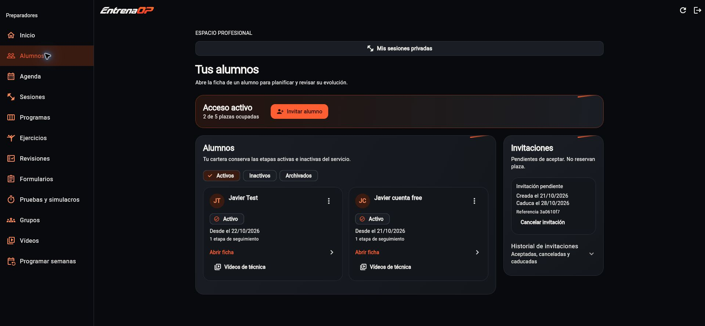
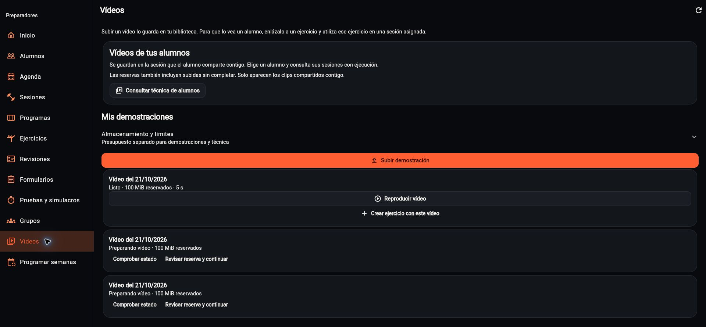

# Trainer: alumnos, invitaciones y técnica · 22/10/2026

Javier solicita mejorar la presentación de alumnos e invitaciones y encontrar
los vídeos enviados por el alumno. Este alcance queda en `trainer_app/`; el
rediseño del deportista se decide después y no necesita trabajo paralelo de
agentes ni cambios en ADMIN.

## Comportamiento

- Cada alumno es una tarjeta pulsable que abre su ficha. El menú secundario
  conserva historial del vínculo, desactivación y archivo/recuperación; estas
  operaciones mantienen sus confirmaciones y sus contratos existentes.
- Las invitaciones pendientes quedan visibles y el historial se pliega.
  Aceptadas/canceladas muestran su fecha real; la referencia identifica la
  invitación y no permite recuperar el secreto. Copiar el código recién creado
  sigue siendo una acción explícita.
- Vídeos separa «Vídeos de tus alumnos» de «Mis demostraciones» y pliega el
  detalle de almacenamiento. Las reservas no se presentan como clips listos.
  Los estados de las demostraciones se traducen al castellano.
- El recorrido de técnica elige alumno, después sesión con ejecución y después
  carga sus clips compartidos. También se accede desde la ficha y desde cada
  pauta ejecutada. Se conserva la consulta por asignación y la retirada de
  compartición; no se crea una bandeja global ni se descargan vídeos al entrar.
- La lista conserva su cursor de paginación, incluso cuando la primera página
  no contiene ejecuciones. No consulta clips de todas las sesiones ni realiza
  consultas de invitaciones en el selector de técnica.
- «Pruebas y simulacros» explica las baterías privadas, su asignación desde la
  ficha del alumno y el registro de intentos/marcas. No calcula puntos oficiales
  ni apto/no apto; las comparaciones requieren condiciones compatibles.
- El favicon reutiliza el PNG de marca existente mediante una copia en Trainer;
  el empaquetador ya versiona su ruta. No modifica archivos de ADMIN.

## Verificación

Análisis de Trainer limpio y batería completa de 170 pruebas correcta. Las
regresiones cubren tarjeta/navegación, gestión sin activación accidental,
invitaciones, texto 2× a 320 y 1100 px, acceso a técnica desde Vídeos, carga
diferida por asignación, paginación y conservación de cuotas/reintentos.
No se cambian modelos, migraciones, RLS, autenticación ni creadores compartidos.

## Publicación Dev comprobada

Publicado únicamente en `public_html/trainer` de Hostinger:

- Revisión: `8513ecd31b7b9d5eb15ed2dd769970b5b6a8c85b`.
- Release: `8513ecd31b7b9d5eb15ed2dd769970b5b6a8c85b-20261022-16`.
- ZIP SHA-256: `739cac7a3297c403b95f5344f3f041e1e1c7ef14ad13d3bbb530091513002a90`.
- Verificador HTTPS correcto: revisión, JavaScript/hash, entrada versionada,
  cabeceras y MIME WebAssembly. El favicon versionado responde y coincide byte
  a byte con el PNG local, SHA-256
  `9963fc69a08debd3deb3d82d05ffdb25ec7ab6429583872ca3babda97e58b294`.

En Chrome se comprueban las dos tarjetas, apertura desde su cuerpo, opciones de
gestión en menú, invitaciones pendientes con historial plegado, separación de
demostraciones/técnica y el recorrido Vídeos → alumno de ensayo → sesión
completada → técnica. La sesión muestra un clip reproducible y otra reserva
incompleta; no se reproduce ni descarga el clip durante esta comprobación.
La ayuda de pruebas aparece y no se crean asignaciones, invitaciones o bajas.

Capturas del portal publicado, sin secretos de invitación ni fotogramas:

Límite: las reservas abandonadas anteriores siguen existiendo. Facilitar la
navegación no convierte esas reservas en vídeos completados ni cambia derechos
de compartición. Tampoco cierra el conjunto de los dieciséis objetivos del
portal profesional.
