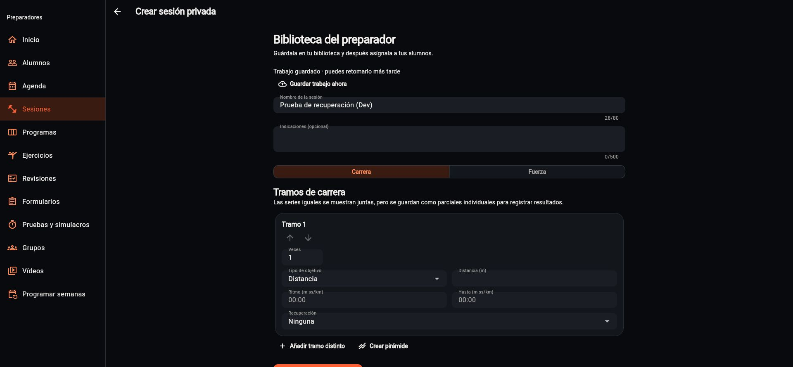

# Publicación Trainer Dev · continuidad y seguimiento · 21/10/2026

Fuente validada y subida: `4ff30d104f2c2d7dad663c64fa2961e10d72d6a0`.
El main posterior puede incorporar correcciones independientes de ADMIN.

- Portal: `https://trainer.entrenaop.es/`, solo EntrenaOP Dev.
- Release: `4ff30d104f2c2d7dad663c64fa2961e10d72d6a0-20261021-11`.
- ZIP: `build/trainer-student-release-20261021.zip`.
- SHA-256 ZIP: `6c2a99dd5d6146932ba55ea42bd3db6f37b02ab5ab892bb76f6c3528ef64108d`.
- SHA-256 JavaScript: `fee1f14baeb92cb4a69eb7ef17e859ffec116754ee6835d1f30f17e0750b12d2`.
- Manifiesto: `sourceTreeDirty: false`, construido `2026-10-21T20:51:41.900407+00:00`.

El ZIP se carga en la carpeta privada `trainer-releases` y se extrae únicamente
en `public_html/trainer`, verificando la ruta antes de activar sobrescritura.
No se cambian ADMIN, la web pública, dominios, permisos ni credenciales.
`trainer_release.py verify` termina correctamente por HTTPS: identidad,
manifiesto, hash JavaScript, entrada, cabeceras de seguridad/no-store y MIME wasm.

## Aceptación real de recuperación

Chrome conserva la sesión MFA de Javier. Desde la biblioteca se abre un trabajo
nuevo con UUID, se escribe «Prueba de recuperación (Dev)» sin completar receta y
se confirma «Guardar trabajo ahora». La interfaz muestra trabajo guardado; al
recargar la misma URL conserva el nombre y el formulario incompleto. Atrás vuelve
a biblioteca y muestra el trabajo en revisión 1. No se crea una sesión asignable,
ni se modifica la sesión «Prueba de entrenador» o sus asignaciones/resultados.
Se conserva ese trabajo de prueba identificado para revisión, en Dev.

La nueva biblioteca de medios explica cómo utilizar demostraciones guardadas.
La aceptación completa de subida/reproducción se registra aparte al completarse;
las pruebas de contrato no se presentan como vídeo real reproducido.

## App del deportista

APK Dev debug compilado: `build/app/outputs/flutter-apk/app-debug.apk`.
SHA-256: `0b9714a60de07ce2fa564a9820c9576ed8d1eb2fee2e2c7059bd22d04fcfd890`.
Tamaño: 280.229.893 bytes. Es un artefacto de prueba ignorado por Git; esta tarea
no lo instala ni acredita distribución iOS o aceptación física completa.

Inicio y bandeja tienen capturas fixture de widgets reales a 390 px, con datos
ficticios y sin desbordamientos. No son capturas de una cuenta real del alumno.
[Contrato, matriz y pendientes del tramo](TRAINER_STUDENT_RECOVERY_2026_10_21.md).
